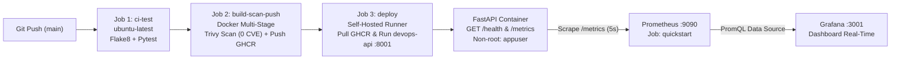

<div align="center">

# 🚀 DevOps FastAPI Project

**REST API berbasis FastAPI dengan Pipeline DevSecOps CI/CD Otomatis, Container Hardening (0 CVE), dan Monitoring Real-Time menggunakan Prometheus & Grafana**

[](https://github.com/amos-kureiju/devops-fastapi-project/actions/workflows/ci-cd.yml)


-1904DA?style=flat&logo=aquasecurity&logoColor=white)


[Ringkasan](#-ringkasan-proyek) •
[Arsitektur](#-arsitektur-sistem) •
[Pipeline CI/CD](#-alur-pipeline-devsecops-cicd) •
[Dokumentasi Visual](#-bukti-implementasi--dokumentasi-visual) •
[Cara Menjalankan](#-panduan-menjalankan-secara-lokal) •
[Troubleshooting](#-devsecops-hardening--troubleshooting)

</div>

---

## 📌 Ringkasan Proyek

**DevOps FastAPI Project** adalah proyek implementasi *end-to-end* **DevSecOps** untuk layanan REST API berbasis Python & FastAPI. Setiap perubahan kode pada branch `main` secara otomatis menjalankan pengujian kualitas kode, pembangunan *container image* yang telah di-*hardening*, pemindaian kerentanan keamanan dengan **Trivy**, distribusi *image* ke **GitHub Container Registry (GHCR)**, deployment otomatis pada **Self-Hosted Runner**, hingga pemantauan metrik secara *real-time* di **Prometheus** dan **Grafana**.

### 🏆 Pencapaian & Metrik Terverifikasi

| Indikator | Hasil Terverifikasi | Keterangan |
| :--- | :--- | :--- |
| **Status Pipeline CI/CD** | ✅ **3 / 3 Jobs Lulus** | `ci-test` (15s), `build-scan-push` (35s), `deploy` (55s) pada commit `50c129a` |
| **Keamanan Container** | 🛡️ **0 CVE (`HIGH` & `CRITICAL`)** | Berhasil memblokir & menuntaskan 5 CVE `HIGH` dari build awal lewat *hardening* |
| **Container Hardening** | 🔒 **Non-Root & Minimal Image** | Multi-stage `python:3.11-slim` (Debian 13.8), patch OS, hapus `pip`/`wheel`/`setuptools`, user `appuser` |
| **Observability** | 📊 **Target `UP` (3 ms scrape)** | Prometheus scrape setiap 5 detik; Grafana merekam metrik `app_request_total` (*real-time*) |

---

## 🏗️ Arsitektur Sistem

Alur kerja sistem dari proses *commit* kode hingga visualisasi metrik di Grafana:



---

## 🧰 Stack Teknologi

| Kategori | Teknologi | Peran Utama |
| :--- | :--- | :--- |
| **Backend API** | Python 3.11, FastAPI, Uvicorn, Prometheus Client | Menyediakan REST API (`/health`) dan eksposur metrik Prometheus (`/metrics`) |
| **Testing & Linting** | Pytest, HTTPX, Flake8 | Validasi gaya kode (PEP 8) dan pengujian unit otomatis |
| **Containerization** | Docker (Multi-Stage Build, `python:3.11-slim`) | Pengemasan aplikasi yang ringkas, aman, dan berjalan dengan user non-root `appuser` |
| **CI/CD & Security** | GitHub Actions, Trivy (`aquasec/trivy:latest`) | Otomatisasi pipeline dan *security gate* (`--exit-code 1` untuk `CRITICAL,HIGH`) |
| **Registry & Deploy** | GitHub Container Registry (GHCR), Self-Hosted Runner | Penyimpanan *container image* bersih dan deployment otomatis pada jaringan `monitoring-net` |
| **Monitoring** | Prometheus (`:9090`), Grafana (`:3001`), Docker Compose | Pengumpulan metrik berkala dan visualisasi trafik API secara *real-time* |

---

## ⚙️ Alur Pipeline DevSecOps CI/CD

Workflow pada [`.github/workflows/ci-cd.yml`](.github/workflows/ci-cd.yml) berjalan otomatis pada setiap `push` dan `pull_request` ke branch `main`:

| Tahap | Runner | Trigger | Tugas Utama | Durasi & Status |
| :--- | :--- | :--- | :--- | :--- |
| **1. `ci-test`** | `ubuntu-latest` | `push` & `pull_request` | Instalasi dependensi, linting dengan `flake8 app tests`, dan unit test dengan `python -m pytest -v` | `15s` ✅ |
| **2. `build-scan-push`** | `ubuntu-latest` | `push` ke `main` | Build Docker multi-stage image, scan Trivy (`--severity CRITICAL,HIGH --exit-code 1 --ignore-unfixed`), lalu push image ke GHCR | `35s` ✅ (`0 CVE`) |
| **3. `deploy`** | `self-hosted` (Windows) | Setelah `build-scan-push` | Memastikan jaringan `monitoring-net` aktif, menghentikan container lama, menarik image terbaru dari GHCR, menjalankan `devops-api` di port `8001:8000`, dan `docker image prune -f` | `55s` ✅ |

---

## 📸 Bukti Implementasi & Dokumentasi Visual

### 1. Pipeline CI/CD GitHub Actions (`All Jobs Passed`)
Seluruh tahap pipeline (`ci-test`, `build-scan-push`, dan `deploy`) berhasil dieksekusi dengan status **Success** pada commit `50c129a`.


---

### 2. Pemindaian Keamanan Container dengan Trivy (`0 CVE HIGH & CRITICAL`)
Gerbang keamanan Trivy memindai *base OS* (`Debian 13.8`) serta seluruh dependensi Python di dalam *container image* dan memastikan **0 kerentanan** sebelum *image* diizinkan naik ke GHCR.

**Ringkasan Laporan Trivy — Bagian 1 (Debian 13.8 & Paket Inti Python):**


**Ringkasan Laporan Trivy — Bagian 2 (`prometheus_client`, `pytest`, `starlette`, `uvicorn` — Clean):**


<details>
<summary>🔍 <strong>Lihat Log Detail Proses Eksekusi Trivy Scanner</strong></summary>

<br>

**Tahap Inisialisasi & Unduh Vulnerability Database Trivy:**


**Deteksi OS Debian 13.8 & Pemindaian Paket Python:**


</details>

---

### 3. Dasbor Monitoring Real-Time Grafana
Grafana terhubung ke Prometheus pada jaringan `monitoring-net` dan menampilkan peningkatan metrik `app_request_total{endpoint="/health", instance="devops-api:8000", job="quickstart"}` secara *real-time* (21 → 41 → 61 permintaan).


---

### 📄 Dokumen Laporan Lengkap (PDF)
Dokumentasi portofolio lengkap (ringkasan arsitektur, verifikasi runtime container, target Prometheus, dan laporan hardening) juga tersedia dalam bentuk PDF:
👉 **[Dokumentasi Proyek DevSecOps FastAPI (PDF)](Docs/Dokumentasi_Proyek_DevSecOps_FastAPI.pdf)**

---

## 🌐 Endpoint API & Pemetaan Port

| Layanan / Endpoint | Alamat Lokal | Port Container | Deskripsi |
| :--- | :--- | :--- | :--- |
| **Health Check API** | `GET http://localhost:8001/health` | `8000` | Mengembalikan `{"status": "ok"}` sekaligus menaikkan counter `app_request_total` |
| **Prometheus Metrics** | `GET http://localhost:8001/metrics` | `8000` | Mengekspos metrik dalam format teks Prometheus |
| **Prometheus UI** | `http://localhost:9090` | `9090` | Scrape target `http://devops-api:8000/metrics` setiap 5 detik (`job: quickstart`) |
| **Grafana Dashboard** | `http://localhost:3001` | `3000` | Visualisasi dasbor monitoring (default login: `admin` / `admin`) |

---

## 📂 Struktur Proyek

```text
devops-fastapi-project/
├── .github/
│   └── workflows/
│       └── ci-cd.yml                              # Pipeline CI/CD & Trivy Security Gate
├── Docs/
│   ├── Dokumentasi 1.png                          # Screenshot Grafana Dashboard
│   ├── Dokumentasi 2.png                          # Screenshot GitHub Actions Summary
│   ├── Dokumentasi 3.png                          # Screenshot Workflow Graph
│   ├── Dokumentasi 3.2.png                        # Log Inisialisasi Trivy Scanner
│   ├── Dokumentasi 3.3.png                        # Log Deteksi OS & Paket Trivy
│   ├── Dokumentasi 3.4.png                        # Report Summary Trivy (Bagian 1)
│   ├── Dokumentasi 3.5.png                        # Report Summary Trivy (Bagian 2)
│   └── Dokumentasi_Proyek_DevSecOps_FastAPI.pdf   # Dokumen Portofolio Lengkap (PDF)
├── app/
│   ├── __init__.py
│   └── main.py                                    # Aplikasi FastAPI (/health & /metrics)
├── monitoring/
│   ├── docker-compose.yml                         # Stack Prometheus & Grafana
│   └── prometheus.yml                             # Konfigurasi target scrape Prometheus
├── tests/
│   ├── __init__.py
│   └── test_main.py                               # Unit test endpoint dengan Pytest
├── .dockerignore
├── .gitignore
├── Dockerfile                                     # Multi-stage build + Container Hardening
├── README.md
└── requirements.txt
```

---

## 🚀 Panduan Menjalankan Secara Lokal

### Prasyarat
- **Python 3.11+**
- **Docker** & **Docker Compose**

### 1. Clone Repositori
```bash
git clone https://github.com/amos-kureiju/devops-fastapi-project.git
cd devops-fastapi-project
```

### 2. Pengujian & Pengembangan Lokal (Tanpa Docker)
```bash
python -m venv venv
# Windows (PowerShell):
.\venv\Scripts\Activate.ps1
# Linux / macOS:
# source venv/bin/activate

pip install -r requirements.txt

# Jalankan linter & unit test
flake8 app tests
python -m pytest -v

# Jalankan server lokal
uvicorn app.main:app --reload --port 8001
```

### 3. Menjalankan Aplikasi & Stack Monitoring dengan Docker
```bash
# 1. Buat jaringan bersama untuk API, Prometheus, dan Grafana
docker network create monitoring-net

# 2. Build & jalankan container FastAPI
docker build -t devops-api:local .
docker run -d --name devops-api --network monitoring-net --restart unless-stopped -p 8001:8000 devops-api:local

# 3. Jalankan Prometheus & Grafana
cd monitoring
docker compose up -d
```

### 4. Verifikasi Layanan
```bash
# Cek respons health check
curl http://localhost:8001/health
# Output: {"status":"ok"}

# Cek metrik Prometheus
curl http://localhost:8001/metrics
```

Buka layanan di browser:
- **Prometheus**: [http://localhost:9090/targets](http://localhost:9090/targets) (pastikan target `devops-api:8000` berstatus `UP`)
- **Grafana**: [http://localhost:3001](http://localhost:3001) (login `admin` / `admin`, tambahkan data source Prometheus `http://prometheus:9090`, lalu buat panel query `app_request_total`)

---

## 🛡️ DevSecOps Hardening & Troubleshooting

Selama pengembangan pipeline, beberapa temuan keamanan dan kendala operasional berhasil dideteksi dan diselesaikan:

| Insiden / Temuan | Akar Masalah | Solusi yang Diterapkan |
| :--- | :--- | :--- |
| **Resolusi Action Trivy & YAML** | Tag `aquasecurity/trivy-action@0.28.0` gagal di-*resolve*, indentasi YAML tidak sejajar, dan potensi karakter BOM di PowerShell `GITHUB_ENV`. | Menjalankan `docker run aquasec/trivy:latest` secara langsung, merapikan struktur YAML, dan menambahkan `-Encoding ascii` pada langkah PowerShell. |
| **5 CVE `HIGH` Terdeteksi Trivy** | Image awal mengandung kerentanan pada `starlette 0.38.6` (3 CVE), `setuptools` (`jaraco.context`, `wheel`), serta paket OS Debian 13.7. | Memperbarui dependensi di `requirements.txt`, menjalankan `apt-get upgrade -y`, serta menghapus `setuptools`, `wheel`, dan `pip` pada tahap akhir `Dockerfile` hingga mencapai **0 CVE**. |
| **Konflik Port 3000 & Runner Pause** | Port host `3000` telah digunakan layanan lain dan jendela PowerShell runner sempat masuk mode *Select*. | Memetakan Grafana ke port `3001:3000` di `monitoring/docker-compose.yml` dan menonaktifkan mode *Select* pada terminal runner. |

---

## 👤 Penulis

**Amos Belsing Arta Baringbing**
- GitHub: [@amos-kureiju](https://github.com/amos-kureiju)
- Repositori: [amos-kureiju/devops-fastapi-project](https://github.com/amos-kureiju/devops-fastapi-project)
